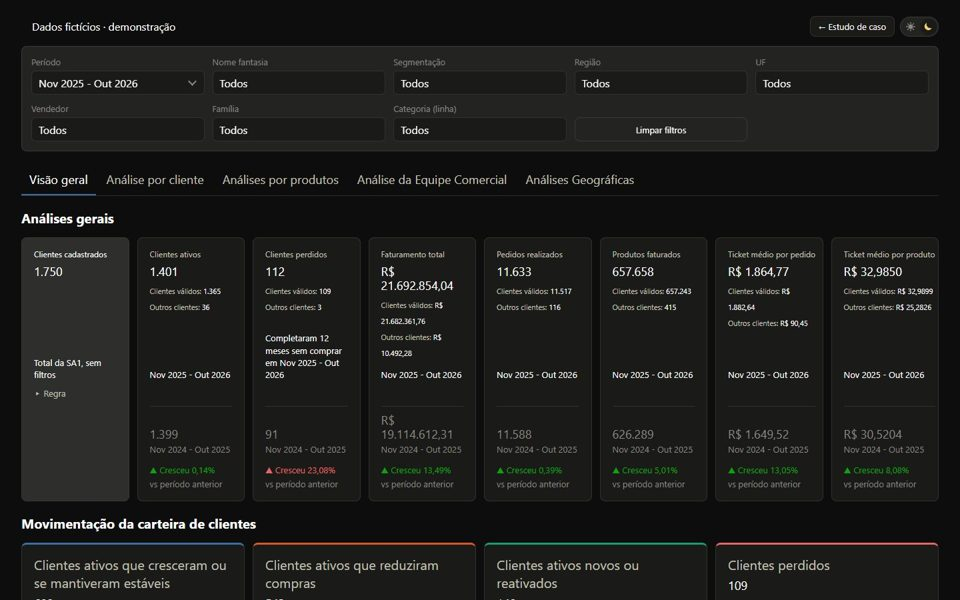

# Vitrine de projetos

Meu portfólio: painéis comerciais, dados e automação, cada um com estudo de caso e demonstração ao vivo.

**[Abrir a vitrine](https://lariantunez.github.io/Vitrine-de-projetos/)**

## O que tem lá

| Projeto | Tema |
|---|---|
| [Diagnóstico Comercial](https://github.com/lariantunez/Diagnostico-Comercial) | Do ERP ao painel 24/7: modelo estrela, pipeline de 11 etapas e validação contra o faturamento oficial |
| [Painel Vitta](https://github.com/lariantunez/painel-sellout-varejo) | Sell out e estoque com importação controlada e cache |
| [Painel Atlas](https://github.com/lariantunez/painel-sellout-de-para) | Sell out com de-para de GTIN entre o código do cliente e o da indústria |
| [Painel Bella](https://github.com/lariantunez/painel-contagem-estoque) | Estoque por contagem manual, com planilha gerada e validação do retorno |
| [Controle Sell Out](https://github.com/lariantunez/painel-acompanhamento-relatorios-sellout) | Controle mensal de relatórios com cobrança por WhatsApp e e-mail |
| [Central de Painéis](https://github.com/lariantunez/central-de-paineis) | Portal que reúne todos os painéis, com área administrativa |
| [Painel de Contratação](https://github.com/lariantunez/painel-de-contratacao) | Funil de contratação de RH com semáforo de prazo e ranking por gestor |
| [Bot RH Meta](https://github.com/lariantunez/Bot-RH-Meta-Painel) | Chatbot de RH no WhatsApp com fila de atendimento humano |

Os projetos rodam em produção com dados das empresas. Nas demonstrações, o código das telas é o mesmo, mas os dados e os nomes são fictícios.

## Stack do site

HTML, CSS e JavaScript puro, com filtro por categoria e tema claro e escuro. Publicado no GitHub Pages.

---

**🇺🇸 English:** my portfolio of sales dashboards, data and automation projects, each with a case study and a live demo. The projects run in production with company data; the demos use the same screen code with fictional data and names.
